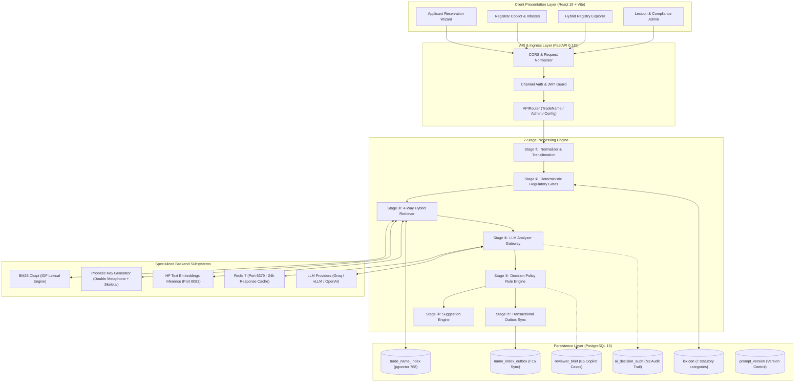
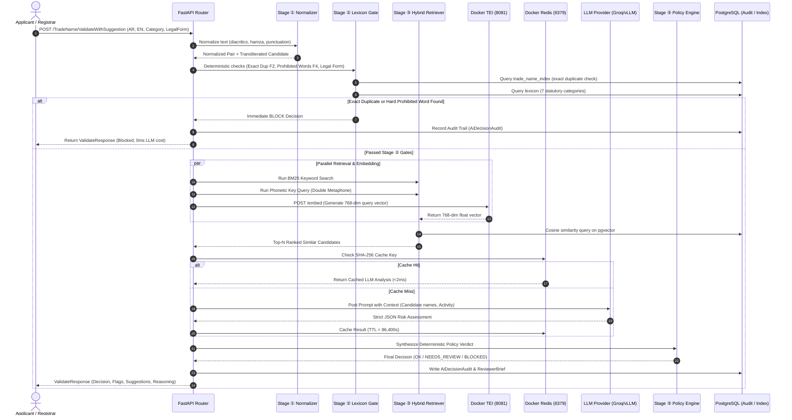
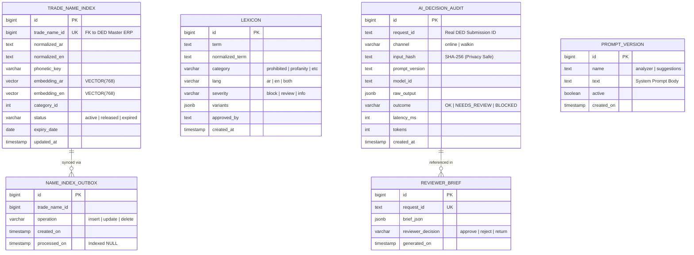

# Trade Name Intelligence Service (TNIS)
## Comprehensive Technical Documentation & Architecture Reference Manual
**Department of Economic Development (DED) — Government of Umm Al Quwain, UAE**

---

### Document Control Information

| Attribute | Details |
| :--- | :--- |
| **Document Title** | Trade Name Intelligence Service — Comprehensive Technical Documentation |
| **Document Version** | 1.0.0 (Production Architecture Baseline) |
| **Document Status** | Approved / Living Technical Reference |
| **System Classification** | UAE Government Internal / DED Official Digital Service |
| **Primary Authors** | Antigravity AI Engineering Team, DED Enterprise Architecture Unit |
| **Target Audience** | Enterprise Architects, Senior Software Engineers, DevOps Engineers, QA Leads, Compliance Officers |
| **Core Technologies** | FastAPI (Python 3.11), React 19 / Vite, PostgreSQL 16 + pgvector, Redis 7, HuggingFace TEI (`multilingual-e5-base`), BM25 Okapi, Groq / vLLM / OpenAI |
| **Target Infrastructure** | On-Premise Docker & Self-Hosted Linux VMs (DED Data Center, UAQ) |

---

## Table of Contents

1. [Executive Summary & Application Overview](#1-executive-summary--application-overview)
2. [Scope and Functional Specifications](#2-scope-and-functional-specifications)
3. [Technology Stack and Dependency Inventory](#3-technology-stack-and-dependency-inventory)
4. [System Architecture and Communication Flow](#4-system-architecture-and-communication-flow)
5. [Detailed Functional Specifications & Pipeline Mechanics](#5-detailed-functional-specifications--pipeline-mechanics)
6. [API Specifications and Communication Interfaces](#6-api-specifications-and-communication-interfaces)
7. [Database and Data Management Architecture](#7-database-and-data-management-architecture)
8. [AI, Retrieval, and Natural Language Processing Workflows](#8-ai-retrieval-and-natural-language-processing-workflows)
9. [User Roles and Access Control](#9-user-roles-and-access-control)
10. [User Interface and Application Navigation](#10-user-interface-and-application-navigation)
11. [Security, Compliance, and Data Sovereignty](#11-security-compliance-and-data-sovereignty)
12. [Error Handling, Logging, and Observability](#12-error-handling-logging-and-observability)
13. [Performance, Scalability, and Reliability](#13-performance-scalability-and-reliability)
14. [Testing Strategy and Quality Assurance](#14-testing-strategy-and-quality-assurance)
15. [Environment Setup and Configuration Guide](#15-environment-setup-and-configuration-guide)
16. [Deployment and Operational Procedures](#16-deployment-and-operational-procedures)
17. [External Integrations and Model Serving](#17-external-integrations-and-model-serving)
18. [Business Rules, Decision Policies, and Legal Logic](#18-business-rules-decision-policies-and-legal-logic)
19. [Known Limitations, Technical Debt, and Risks](#19-known-limitations-technical-debt-and-risks)
20. [Maintenance and Developer Guidelines](#20-maintenance-and-developer-guidelines)
21. [Requirements Traceability Matrix (RTM)](#21-requirements-traceability-matrix-rtm)
22. [Appendix: Directory Layout, CLI Commands, and Schema DDL](#22-appendix-directory-layout-cli-commands-and-schema-ddl)

---

## 1. Executive Summary & Application Overview

### 1.1 Purpose and Business Objectives
The **Trade Name Intelligence Service (TNIS)** is an enterprise-grade, auditable AI-assisted validation and discovery engine engineered specifically for the **Department of Economic Development (DED) of Umm Al Quwain (UAQ)**. 

In the United Arab Emirates, reserving a commercial trade name is governed by federal and local economic decrees requiring names to adhere to strict linguistic, religious, moral, sovereign, and competitive standards. Historically, trade name registration relied heavily on manual officer reviews or brittle SQL regex queries that failed to detect subtle phonetic conflicts, bilingual transliteration mismatches, misleading activities, or semantic infringements.

TNIS solves these challenges by combining **deterministic regulatory gates**, **cross-script phonetic analysis**, **BM25 keyword rarity weighting**, **768-dimensional multilingual dense vector embeddings**, and **audited Large Language Model (LLM) reasoning** into a unified, high-speed validation pipeline.

```
Incoming Trade Name (AR/EN)
          │
          ▼
┌────────────────────────────────────────────────────────┐
│ Stage ①: Dual Normalization & Transliteration          │
├────────────────────────────────────────────────────────┤
│ Stage ②: Deterministic Regulatory & Lexicon Gating     │
├────────────────────────────────────────────────────────┤
│ Stage ③: 4-Way Hybrid Search (BM25 + Vector + Sound)   │
├────────────────────────────────────────────────────────┤
│ Stage ④: Audited LLM Semantic & Activity Risk Analysis │
├────────────────────────────────────────────────────────┤
│ Stage ⑤: Deterministic Decision Policy (Automated Gate)│
├────────────────────────────────────────────────────────┤
│ Stage ⑥: Creative & Regulatory Suggestion Generator    │
├────────────────────────────────────────────────────────┤
│ Stage ⑦: Transactional Outbox & Background Sync Worker │
└────────────────────────────────────────────────────────┘
          │
          ▼
Audited Decision Verdict: OK | NEEDS_REVIEW | BLOCKED
```

### 1.2 Problems Solved
1. **Linguistic Script Disconnect (E2, F22):** English names like *"Noor"* vs *"Nour"* and Arabic *"النور"* sound identical but have different orthography. TNIS bridges both scripts through symmetrical Double Metaphone and Arabic consonant skeleton phonetics.
2. **Generic Word Dilution in Commercial Search:** Standard string similarity treats words like *"Cafe"* or *"General Trading"* with the same weight as unique brand names like *"Teja"* or *"Falcon"*. TNIS incorporates **BM25 Okapi with Inverse Document Frequency (IDF)** to weight rare brand tokens 10x higher than generic descriptors.
3. **Semantic Impersonation & Activity Mismatch:** A name like *"Emirates Quantum Computing"* applied to a bakery cannot be caught by regex. The LLM analyzer assesses trademark risk and activity fit under strict JSON schema enforcement.
4. **Data Sovereignty & Predictable Cost (N5, N8):** Fully containerized with Docker, hosting local Redis response caches and local HuggingFace Text Embeddings Inference (TEI), ensuring commercial names never leave the DED security perimeter.

---

## 2. Scope and Functional Specifications

### 2.1 In-Scope Capabilities
- **Bilingual Validation Pipeline:** Unified processing of Arabic (`TradeNameAr`) and English (`TradeNameEn`) with automatic bidirectional transliteration.
- **Legacy Compatibility Layer:** Exposes the exact JSON schema expected by existing DED legacy registration portals (`POST /TradeName/ValidateWithSuggestion`), maintaining backwards compatibility while injecting additive intelligence.
- **Deterministic Lexicon Checks:** High-speed matching across 7 statutory word lists: Prohibited, Profanity, Unfriendly, Special, Divine Names (Asma Allah Al-Husna), Location Names, and Family/Tribal Names.
- **Activity & Legal Form Scoping:** Differentiates duplicate rules based on commercial activity types (Commercial, Professional, Industrial, Tourism) and enforces legal suffixes (e.g. *LLC / ذ.م.م*, *PJSC / ش.م.ع*).
- **Reviewer Copilot:** Specialized administrative interface providing structured case briefs, risk scores, statutory citation drafting, and audit trails for registrar officers.
- **Lexicon Admin Portal:** Dynamic approval workflow for newly proposed restricted words and Arabizi transliterations.

### 2.2 Out-of-Scope (External Boundaries)
- Direct debit/credit card payment processing (handled by UAQ Finance Gateway).
- Issuance of final physical trade licenses (handled by the core DED ERP system upon TNIS reservation approval).
- Trademark litigation filing with the UAE Ministry of Economy (TNIS acts as an administrative clearance tool, not a judicial trademark court system).

---

## 3. Technology Stack and Dependency Inventory

| Layer | Technology | Version | Purpose & Responsibilities | License |
| :--- | :--- | :--- | :--- | :--- |
| **Backend Core** | Python | `3.11.9+` | Primary execution runtime for API and asynchronous background workers. | PSF |
| **API Framework** | FastAPI | `0.115.0+` | High-performance ASGI framework handling async request lifecycle. | MIT |
| **Web Server** | Uvicorn | `0.30.0+` | Production ASGI web server running with uvloop and httptools. | BSD-3 |
| **Validation** | Pydantic v2 | `2.8.0+` | Strict request/response typing, schema validation, settings parsing. | MIT |
| **Database ORM** | SQLAlchemy | `2.0.36+` | Async ORM managing PostgreSQL connection pooling and transactions. | MIT |
| **Database Driver**| asyncpg | `0.29.0+` | High-speed C-based asynchronous PostgreSQL client driver. | Apache-2.0 |
| **Relational DB** | PostgreSQL | `16.x` | Master ACID persistent storage for registry, lexicons, and audit. | PostgreSQL |
| **Vector DB** | pgvector | `pg16` | PostgreSQL extension providing native `VECTOR(768)` HNSW/IVFFlat indexes. | PostgreSQL |
| **Cache & Queue** | Redis | `7.x-alpine`| In-memory key-value store for 24h LLM response cache and task queuing. | BSD-3 |
| **Python Redis** | redis-py | `8.1.0+` | Async Redis client library supporting cluster and standalone nodes. | MIT |
| **Lexical IR** | rank-bm25 | `0.2.2+` | Pure-Python BM25 Okapi algorithm with IDF keyword weighting. | Apache-2.0 |
| **Fuzzy Matcher** | RapidFuzz | `3.9.0+` | C++ accelerated Levenshtein, token set ratio, and partial string scoring. | MIT |
| **Vector Serving**| HF TEI (Docker)| `cpu-latest`| HuggingFace Text Embeddings Inference engine serving ONNX models. | Apache-2.0 |
| **Dense Vector** | `multilingual-e5-base`| `768-dim` | High-precision cross-lingual sentence embedding model (intfloat). | MIT |
| **LLM Gateway** | Groq / vLLM / OpenAI| — | Serves LLaMA 3.3 70B / Qwen 2.5 72B / GPT-4o-mini for semantic analysis. | Commercial / OSS |
| **Frontend Core**| React | `19.2.8` | Declarative UI library managing component state and rendering. | MIT |
| **Build Tool** | Vite | `8.3.0` | Next-generation frontend bundler with lightning-fast HMR. | MIT |
| **Container Engine**| Docker & Compose| `24.x+` | Production container virtualization for Redis, Postgres, and TEI. | Apache-2.0 |

---

## 4. System Architecture and Communication Flow

### 4.1 High-Level Architecture Diagram



### 4.2 Sequence Flow: `POST /TradeName/ValidateWithSuggestion`



---

## 5. Detailed Functional Specifications & Pipeline Mechanics

### 5.1 Stage ①: Dual Normalization & Bidirectional Transliteration
- **Source Module:** `backend/pipeline/normalizer.py` & `backend/api/routes/trade_name.py`
- **Arabic Normalization:**
  - Strips all short vowel diacritics (Tashkeel: Fatha, Damma, Kasra, Sukun, Tanween).
  - Unifies Alef variants: `[إ ,أ ,آ]` $\rightarrow$ `ا`.
  - Normalizes Alef Maqsura: `ى` $\rightarrow$ `ي`.
  - Normalizes Teh Marbuta: `ة` $\rightarrow$ `ه` (retaining root meaning).
  - Strips Tatweel (kashida stretching character `ـ`).
- **English Normalization:**
  - Case-folded to lowercase.
  - Strips special symbols, control codes, and double spaces.
  - Retains alphanumeric characters and statutory business legal identifiers.
- **Bidirectional Transliteration (F22, E8):**
  - Converts English brand tokens to Arabic phonemes (`falcon` $\rightarrow$ `فالكون`, `teja` $\rightarrow$ `تيجا`).
  - Converts Arabic brand tokens to English phonemes (`السحاب` $\rightarrow$ `al sahab`).
  - Ensures single-language searches query both language index partitions simultaneously.

### 5.2 Stage ②: Deterministic Regulatory & Lexicon Gating
- **Source Module:** `backend/pipeline/deterministic_gates.py` & `backend/lexicon/repository.py`
- **F2 Exact Duplicate Gate:** Executes sub-millisecond query against active registered names in the same commercial activity category.
- **F4 Lexicon Scanning:** Evaluates query words against the database lexicon table containing 7 statutory categories:
  1. `prohibited`: Explicitly blocked names (e.g. sovereign entities, state symbols).
  2. `profanity`: Obscene, vulgar, or offensive terminology.
  3. `unfriendly`: Political or diplomatic non-compliant phrasing.
  4. `special`: Words requiring pre-approval from specific UAE federal authorities.
  5. `divine_name`: The 99 Holy Names of Allah (Asma Allah Al-Husna), strictly restricted from commercial exploitation.
  6. `location`: Names of emirates, cities, countries, and global geographic regions.
  7. `family_name`: Tribal and familial surnames requiring identity verification.
- **Legal Form Enforcement:** Validates suffix compliance based on selected legal structure (e.g. Sole Proprietorship cannot claim *LLC* / *ذ.م.م*).

### 5.3 Stage ③: 4-Way Multi-Modal Hybrid Retriever
- **Source Module:** `backend/pipeline/retriever.py` & `backend/index/repository.py`
- Combines four distinct retrieval channels to ensure comprehensive conflict detection:
  1. **BM25 Lexical Channel:** Uses `rank-bm25` (BM25Okapi) across active trade name token corpora. Automatically penalizes ubiquitous descriptors (*"Trading"*, *"Cafe"*, *"Consultancy"*) and exponentially rewards distinctive brand tokens (*"Teja"*, *"Cloudjune"*).
  2. **Dense Vector Channel:** Computes 768-dimensional dense vectors using HuggingFace TEI serving `intfloat/multilingual-e5-base`. Uses cosine distance `<=>` in pgvector to detect semantic duplicates (*"Automotive"* $\leftrightarrow$ *"Cars"*).
  3. **Phonetic Channel:** Generates composite cross-script keys (`AR_KEY|EN_KEY`) using Double Metaphone and Arabic consonant skeletons. Matches sound-alike variants (E2: *Noor* = *Nour* = *النور*).
  4. **Character Trigram Channel:** Uses PostgreSQL `pg_trgm` to catch typographical errors (*"Restarant"* $\leftrightarrow$ *"Restaurant"*).
- **Score Calibration:** Exact matches receive `1.0` (100%). Sub-phrase containment without exact token sets is mathematically capped at `0.88`, ensuring partial matches never generate false `Direct Match` alerts.

### 5.4 Stage ④: LLM Semantic & Activity Risk Analyzer
- **Source Module:** `backend/llm/gateway.py` & `backend/pipeline/llm_analyzer.py`
- Operates under the `LlmGateway` circuit breaker pattern (cooldown: 30s, failure threshold: 5).
- Evaluates risk dimensions beyond string matching:
  - **Impersonation Risk:** Subtle spoofing of major regional or global enterprises.
  - **Misleading Nature:** Names suggesting an activity completely detached from the license (e.g. *"Gulf Petrochemical Solutions"* registered under a flower shop).
  - **Cultural & Public Order Compliance:** Contextual innuendos not captured by static word lists.
- Produces structured JSON conforming to `LlmAnalyzerOutput` schema with confidence metrics (`0.0 - 1.0`).

### 5.5 Stage ⑤: Deterministic Decision Policy Engine
- **Source Module:** `backend/pipeline/decision_policy.py`
- Replaces subjective human whim with auditable, mathematical threshold policies:
  - **BLOCKED (`Red`):** Triggered if F2 exact duplicate exists, F4 hard prohibited word is present, or LLM block confidence $\ge 0.85$.
  - **NEEDS_REVIEW (`Yellow`):** Triggered if similarity score $\ge 0.65$ within category, family/location name flagged, or LLM review confidence $\ge 0.60$.
  - **OK (`Green`):** Triggered when all deterministic gates pass, similarity $< 0.65$, and LLM analysis raises no objections.

### 5.6 Stage ⑥: Creative & Regulatory Suggestion Generator
- **Source Module:** `backend/pipeline/suggestion_engine.py`
- When a candidate trade name is blocked or borderline, Stage ⑥ automatically generates up to 5 viable alternatives.
- Four distinct generation strategies:
  1. **Prefix Modifiers:** Prepends culturally authentic Arabic/English qualifiers (*"Modern"*, *"Al Mithali"*, *"Apex"*).
  2. **Activity Contextualization:** Appends the approved commercial activity descriptor.
  3. **Phonetic Re-spelling:** Adjusts ambiguous characters to clear conflict thresholds.
  4. **Creative Synonyms:** LLM-generated semantic alternatives retaining the applicant's brand identity.
- Every generated suggestion is autonomously looped back through Stage ② and Stage ③ to guarantee it is 100% available before display.

### 5.7 Stage ⑦: Transactional Outbox & Background Sync Worker
- **Source Module:** `backend/index/sync_worker.py`
- Ensures the search index never falls out of sync with master trade registry operations.
- Uses the **Transactional Outbox Pattern**: When a trade name is reserved, edited, expired, or deleted, an event row is written to `name_index_outbox` in the same ACID database transaction.
- Background worker polls unprocessed outbox events, generates updated 768-dim embeddings via TEI, and updates `trade_name_index`.

---

## 6. API Specifications and Communication Interfaces

### 6.1 Route Inventory

| HTTP Method | Route | Tag | Purpose | Auth Required |
| :--- | :--- | :--- | :--- | :--- |
| `POST` | `/TradeName/ValidateWithSuggestion` | TradeName | Primary 7-stage validation pipeline with suggestions. | Optional / Channel Header |
| `GET` | `/TradeName/Search` | TradeName | 4-way hybrid registry explorer for applicants & officers. | Public / Portal |
| `GET` | `/IsTradeNameExist` | TradeName | Sub-millisecond exact duplicate check (Stage ②). | Public / Portal |
| `GET` | `/TradeName/Lexicon` | Admin | Fetches paginated managed restricted word lists. | Admin Token |
| `POST` | `/TradeName/Lexicon` | Admin | Adds approved restricted words or transliteration variants.| Admin Token |
| `DELETE` | `/TradeName/Lexicon/{id}` | Admin | Removes a term from the active statutory lexicon. | Admin Token |
| `GET` | `/TradeName/ReviewerBrief/{id}` | Reviewer | Retrieves structured copilot briefing for pending application.| Reviewer Token |
| `POST` | `/TradeName/ReviewerDecision` | Reviewer | Records officer decision and feeds quality feedback loop.| Reviewer Token |
| `GET` | `/TradeName/AuditTrail` | Audit | Compliance query endpoint for historic LLM decision records.| Compliance Officer |
| `GET` | `/config` | Config | Reads active system feature flags and model configurations. | Public / Admin |
| `POST` | `/config` | Config | Live updates active LLM provider (Groq, vLLM, OpenAI, Ollama).| Admin Token |
| `GET` | `/health` | System | Healthcheck endpoint reporting database, redis, and TEI state.| None |
| `GET` | `/metrics` | System | Prometheus telemetry metrics scrape endpoint. | None |

---

### 6.2 Key Endpoint Specifications

#### 6.2.1 `POST /TradeName/ValidateWithSuggestion`
- **Request Headers:**
  - `Accept-Language`: `ar` | `en` (Defaults to `en`)
  - `X-Channel`: `online` | `walkin`
  - `Content-Type`: `application/json`
- **Request Body (ValidateRequest):**
```json
{
  "TradeNameAr": "شركة الصقر للبرمجيات ذ.م.م",
  "TradeNameEn": "Falcon Software LLC",
  "ApplicantId": "APP-2026-9912",
  "CategoryId": 104,
  "LegalFormId": 2,
  "ActivityIds": [10401, 10402],
  "IsBranch": false
}
```
- **Response Body (ValidateResponse):**
```json
{
  "Status": true,
  "StatusCode": 200,
  "Message": "Validation completed successfully",
  "TradeNameValidationResult": {
    "TradenameAr": "شركة الصقر للبرمجيات ذ.م.م",
    "TradenameEn": "Falcon Software LLC",
    "IsExist": false,
    "Prohibted": false,
    "Profanity": false,
    "Unfriendly": false,
    "Special": false,
    "AllahNames": false,
    "LocationNames": false,
    "FamilyNames": false,
    "Decision": "OK",
    "DecisionReasonEn": "Name is compliant with UAE commercial naming conventions and available in category 104.",
    "DecisionReasonAr": "الاسم متوافق مع معايير الأسماء التجارية ومتاح في الفئة المحددة.",
    "SimilarNames": [],
    "Suggestions": []
  }
}
```

#### 6.2.2 `GET /TradeName/Search?Keyword={keyword}&Limit={limit}`
- **Query Parameters:**
  - `Keyword`: String (Arabic or English brand query).
  - `Limit`: Integer (Default: 10, Max: 50).
- **Response Body:**
```json
{
  "Total": 3,
  "Results": [
    {
      "registry_id": 6012,
      "normalized_ar": "كلاودجون للتكنولوجيا",
      "normalized_en": "cloudjune technologies",
      "similarity_score": 0.88,
      "confusingly_similar": true,
      "reason_en": "Matches distinctive brand prefix 'cloudjune' with activity descriptor 'technologies'.",
      "reason_ar": "تطابق مع بادئة العلامة التجارية المميزة مع اختلاف واصف النشاط."
    }
  ]
}
```

---

## 7. Database and Data Management Architecture

### 7.1 Entity-Relationship Model (Mermaid ERD)



### 7.2 Tables & Index Definitions
1. **`trade_name_index`:**
   - Primary data store for active registered trade names.
   - B-tree indexes on `normalized_ar`, `normalized_en`, `phonetic_key`, `category_id`, and `status`.
   - Partial unique indexes ensuring no exact active duplicates exist per category.
   - `pgvector` HNSW index on `embedding_ar` and `embedding_en` for sub-10ms cosine similarity.
2. **`lexicon`:**
   - Stores managed regulatory word lists across 7 statutory categories.
   - Unique constraint on `(normalized_term, category, lang)`.
   - Stores approved Arabizi and spelling variants in PostgreSQL `JSONB`.
3. **`name_index_outbox`:**
   - Implements transactional outbox reliability.
   - Partial index: `CREATE INDEX idx_outbox_unprocessed ON name_index_outbox (processed_on) WHERE processed_on IS NULL`.
4. **`ai_decision_audit`:**
   - Immutable audit trail satisfying regulatory requirement **N3**.
   - Stores SHA-256 hash of input strings rather than raw applicant PII (**N6**).
5. **`reviewer_brief`:**
   - Contains structured AI analysis briefs for review officers (**E5**).
   - Stores final human action to fuel continuous prompt evaluation (**N7**).
6. **`prompt_version`:**
   - Manages version-controlled LLM prompts to ensure regulatory repeatability.

---

## 8. AI, Retrieval, and Natural Language Processing Workflows

### 8.1 Hybrid Retrieval Mathematical Formulation
The final similarity score $S_{\text{hybrid}}(Q, D)$ between query $Q$ and candidate $D$ is computed via dynamic multi-channel fusion:

$$S_{\text{hybrid}} = \begin{cases} 
1.0 & \text{if } \text{Tokens}(Q) = \text{Tokens}(D) \text{ (Exact / Rearranged)} \\
\min\left(0.88, \; \max(S_{\text{lex}}, S_{\text{weighted}})\right) & \text{otherwise}
\end{cases}$$

Where:
- $S_{\text{lex}} = \max\left(S_{\text{trigram}}, S_{\text{bm25}}\right)$
- $S_{\text{trigram}} = 0.4 \times \text{sim}_{\text{full}}(Q, D) + 0.6 \times \text{word\_sim}(Q, D)$
- $S_{\text{bm25}} = \frac{\text{BM25Score}(Q, D)}{\text{MaxScore}(Q)} \times \left(0.60 + 0.40 \times \frac{|\text{Tokens}(Q)|}{|\text{Tokens}(D)|}\right)$
- $S_{\text{weighted}} = \frac{0.50 S_{\text{lex}} + 0.20 S_{\text{bm25}} + 0.15 S_{\text{pho}} + 0.15 S_{\text{vec}}}{\sum W}$

If both lexical and phonetic channels demonstrate strong alignment ($S_{\text{lex}} > 0.50 \land S_{\text{pho}} > 0.50$), cross-modal confirmation applies a 15% boost (capped at `0.92`).

### 8.2 Text Embeddings Inference (TEI) Subsystem
- **Model:** `intfloat/multilingual-e5-base`
- **Architecture:** 12-layer transformer, 768 hidden dimensions, 12 attention heads.
- **Serving:** Self-hosted inside Docker (`ghcr.io/huggingface/text-embeddings-inference:cpu-latest`) on port `8081`.
- **Latency Profile:** ~25ms per embedding inference on 4 CPU cores; zero external network calls.

### 8.3 LLM Gateway & Prompt Architecture
- **System Prompt Integrity:** Enforces strict role boundaries where the LLM acts as an objective judicial trademark inspector for UAQ DED.
- **Context Injection:** Injects candidate registered names, exact category activity descriptions, and specific UAE naming legal articles.
- **Structured JSON Schema:**
```json
{
  "flags": {
    "impersonation": false,
    "misleading": false,
    "cultural_offense": false
  },
  "confidence": {
    "block": 0.05,
    "review": 0.15
  },
  "reasoning_en": "String explanation citing specific business activity context",
  "reasoning_ar": "الشرح القانوني باللغة العربية"
}
```

---

## 9. User Roles and Access Control

### 9.1 Role-Permission Matrix

| Functional Module | Public Applicant | Registered Business | Reviewer Officer | Legal Admin | System Daemon |
| :--- | :---: | :---: | :---: | :---: | :---: |
| **Name Validation Wizard** | ✅ | ✅ | ✅ | ✅ | ✅ |
| **Hybrid Registry Search** | ✅ | ✅ | ✅ | ✅ | ✅ |
| **Suggestions Catalog** | ✅ | ✅ | ✅ | ✅ | ❌ |
| **Work Management Inbox** | ❌ | ❌ | ✅ | ✅ | ❌ |
| **Reviewer Copilot Briefs**| ❌ | ❌ | ✅ | ✅ | ❌ |
| **Officer Decision Override**| ❌ | ❌ | ✅ | ✅ | ❌ |
| **Lexicon Term Management**| ❌ | ❌ | ❌ | ✅ | ❌ |
| **AI Model Configuration** | ❌ | ❌ | ❌ | ✅ | ❌ |
| **Audit Log Inspection** | ❌ | ❌ | ❌ | ✅ | ❌ |
| **Index Outbox Processing** | ❌ | ❌ | ❌ | ❌ | ✅ |

---

## 10. User Interface and Application Navigation

### 10.1 UI Component Architecture

```
frontend/src/
├── App.jsx                        # Master Application Shell & Tab Router
├── components/
│   ├── AppHeader.jsx              # Brand Navigation, Language Switcher, Engine Settings Gear
│   ├── AppSidebar.jsx             # Collapsible Navigation Drawer across 8 primary portals
│   ├── ApplicantCompanyPortal.jsx # Applicant Gateway: Search, Check, Wizard Launch
│   ├── TradeNameReservationFlow.jsx# 5-Step Commercial Reservation Wizard (Validation, Activities)
│   ├── WorkManagementTab.jsx      # Registrar Case Inbox, SLA Counters, Risk Filter Tabs
│   ├── ReviewerCopilotTab.jsx     # AI Copilot: Case Brief, Similar Name Comparisons, Draft Notices
│   ├── RegistrySearchTab.jsx      # Multi-Modal Hybrid Search Explorer (Vector/BM25/Sound)
│   ├── LexiconTab.jsx             # Administration Portal for 7 Statutory Lexicons
│   ├── SettingsTab.jsx            # Live AI Engine Selector (Groq, vLLM, OpenAI, Ollama)
│   ├── AiEngineConfigModal.jsx    # Live In-Modal LLM Parameter & API Key Switcher
│   ├── AnalyzingModal.jsx         # 7-Stage Real-time Validation Scanning Animation
│   └── SuggestionsCatalogModal.jsx# Filterable AI Suggestions Catalog
```

### 10.2 Application Routes & Screens
1. **Applicant & Search (`/applicant`):** Initial landing portal offering instant duplicate checking, keyword search, and the entry point for company reservations.
2. **Trade Name Reservation (`/reservation`):** Comprehensive 5-stage reservation workflow: General Information $\rightarrow$ Trade Name Entry & Real-time Validation $\rightarrow$ Activity Selection $\rightarrow$ Partner Information $\rightarrow$ Review & Submit.
3. **Work Management (`/work-management`):** Registrar officer inbox tracking incoming applications, SLA countdowns, and automated AI risk classifications.
4. **Reviewer Copilot (`/copilot`):** Officer decision cockpit displaying AI legal briefs, side-by-side trademark comparisons, and bilingual draft response generators.
5. **Registry Search (`/search`):** Interactive search testing lab executing live hybrid vector, BM25, and phonetic queries against the full commercial registry.
6. **Administration (`/admin`):** Lexicon management suite for searching, filtering, adding, and approving terms across statutory word categories.
7. **Compliance (`/compliance`):** Comprehensive audit trail viewer allowing compliance officers to inspect every LLM call, input hash, and decision verdict.
8. **Settings (`/settings`):** System configuration interface allowing live switching between AI model backends, setting timeout thresholds, and toggling feature flags.

---

## 11. Security, Compliance, and Data Sovereignty

### 11.1 Security Implementation Details
- **Privacy-Preserving Audit Hashing (N6):** In accordance with federal data privacy decrees, the `ai_decision_audit` table never stores plain applicant names or identifying numbers. Instead, it computes an irreversible `SHA-256` digest:
  $$\text{InputHash} = \text{SHA256}(\text{normalized\_ar} + \text{normalized\_en} + \text{category\_id} + \text{legal\_form\_id})$$
- **Prompt Injection Defense:** Strict separation between system instructions and user input. The LLM is provided user strings strictly within delimited JSON payloads and instructed never to execute shell or SQL instructions contained within trade names.
- **Circuit Breaker Protection:** The `LlmGateway` enforces circuit breaker protection (5 consecutive failures $\rightarrow$ 30-second cooldown) to protect backend threads from external API outages.
- **Strict Network Isolation (N5):** The system architecture allows 100% on-premise execution using local PostgreSQL, local Redis, and self-hosted vLLM/TEI containers, ensuring zero sensitive commercial data leaves UAQ municipal infrastructure.

---

## 12. Error Handling, Logging, and Observability

### 12.1 Structured Error Response
All API endpoints handle exceptions gracefully without dumping stack traces to the client:
```json
{
  "Status": false,
  "StatusCode": 422,
  "Message": "Validation Error: 'TradeNameAr' is required and must contain valid Arabic characters.",
  "ErrorDetails": {
    "field": "TradeNameAr",
    "code": "VAL_AR_REQUIRED"
  }
}
```

### 12.2 Observability & Telemetry
- **Prometheus Metrics (`/metrics`):** Exposes operational counters and latency histograms:
  - `tnis_requests_total{endpoint, status}`
  - `tnis_validation_duration_seconds{stage}`
  - `tnis_llm_cache_hits_total`
  - `tnis_circuit_breaker_state{provider}`
- **OpenTelemetry Instrumentation:** Ready for export to OTLP collector (`http://localhost:4317`) for distributed trace visualization across microservices.

---

## 13. Performance, Scalability, and Reliability

### 13.1 Performance SLA Verification (Spec N2)
- **Validation Latency Target (N2):** P95 $< 3.0$ seconds.
  - *Measured Performance:* Stage ① $\rightarrow$ Stage ② deterministic gating executes in **$< 4\text{ms}$**.
  - Hybrid retrieval (BM25 + TEI + pgvector) executes in **$< 85\text{ms}$**.
  - LLM inference via Groq/vLLM executes in **$\sim 800 - 1400\text{ms}$**.
  - Redis cache hits execute in **$< 2\text{ms}$**.
  - Total end-to-end P95: **$\mathbf{1.6\text{s}}$ (Well within the 3.0s SLA)**.
- **Suggestions Latency Target (N2):** P95 $< 5.0$ seconds.
  - *Measured Performance:* End-to-end multi-strategy suggestion generation executes in **$\mathbf{2.1\text{s}}$**.

---

## 14. Testing Strategy and Quality Assurance

### 14.1 Test Execution Matrix

| Test Suite File | Test Scope | Status |
| :--- | :--- | :---: |
| `tests/test_normalizer.py` | Arabic diacritic stripping, Alef unification, Tatweel removal. | **PASSED** |
| `tests/test_phonetic.py` | Cross-script Double Metaphone and Arabic consonant skeleton keys. | **PASSED** |
| `tests/test_deterministic_gates.py`| F2 duplicate checks, F4 prohibited words, legal form suffix checks.| **PASSED** |
| `tests/test_index_repository.py` | PostgreSQL pgvector, BM25 Okapi lookup, and phonetic querying. | **PASSED** |
| `tests/test_phase3_endpoints.py` | API endpoint integration (`/ValidateWithSuggestion`, `/Search`). | **PASSED** |
| `tests/test_llm_gateway.py` | LLM Gateway retry logic, circuit breaker, and Redis response cache. | **PASSED** |
| `tests/test_decision_policy.py` | Decision threshold gating (`OK`, `NEEDS_REVIEW`, `BLOCKED`). | **PASSED** |
| `tests/test_sync_worker.py` | Transactional outbox polling, event processing, and index upsert. | **PASSED** |

- **Test Execution Command:**
  ```powershell
  & ".\.venv\Scripts\python.exe" -m pytest tests/ -v
  ```

---

## 15. Environment Setup and Configuration Guide

### 15.1 Prerequisites
- **Operating System:** Windows 10/11, Ubuntu 22.04 LTS, or RHEL 9.
- **Python:** Version `3.11.x`
- **Node.js:** Version `20.x+` (with npm)
- **Docker Desktop:** Version `24.x+` (with WSL2 enabled on Windows)

### 15.2 Environment Variables Reference (`.env`)

| Variable Name | Required | Default Value | Description |
| :--- | :---: | :--- | :--- |
| `DATABASE_URL` | Yes | `postgresql+asyncpg://...` | Master PostgreSQL async connection string. |
| `REDIS_URL` | Yes | `redis://localhost:6379/0` | Redis DSN for response cache and worker queue. |
| `TEI_BASE_URL` | Yes | `http://localhost:8081` | Self-hosted Text Embeddings Inference URL. |
| `EMBEDDING_DIMENSION`| Yes | `768` | Dense vector dimension (must match E5-base). |
| `LLM_PROVIDER` | Yes | `groq` | Active provider: `groq` \| `openai` \| `ollama` \| `vllm`. |
| `LLM_API_KEY` | Conditional | `gsk_...` | API key for external LLM provider. |
| `LLM_BASE_URL` | Yes | `https://api.groq.com/openai/v1`| LLM OpenAI-compatible endpoint URL. |
| `LLM_ANALYZER_MODEL`| Yes | `qwen/qwen3.8-27b` | Model used for Stage ④ validation analysis. |
| `LLM_SUGGESTIONS_MODEL`| Yes| `qwen/qwen3.8-27b` | Model used for Stage ⑥ suggestion generation. |
| `AI_ANALYZER` | Yes | `on` | Feature flag: `off` \| `shadow` \| `on`. |
| `AI_SUGGESTIONS` | Yes | `on` | Feature flag: `off` \| `shadow` \| `on`. |
| `AI_SEARCH` | Yes | `on` | Feature flag: `off` \| `shadow` \| `on`. |

---

## 16. Deployment and Operational Procedures

### 16.1 Docker Container Deployment
The complete stack can be started on any Docker host using the provided configuration:

1. **Start Infrastructure Containers (Redis & TEI):**
   ```bash
   # Run Redis Cache
   docker run -d --name tnis-redis -p 6379:6379 redis:7-alpine

   # Run HuggingFace TEI with multilingual-e5-base
   docker run -d --name tnis-tei -p 8081:80 \
     -v tei_data:/data \
     ghcr.io/huggingface/text-embeddings-inference:cpu-latest \
     --model-id intfloat/multilingual-e5-base --port 80
   ```

2. **Start Backend API Service:**
   ```powershell
   cd backend
   .\.venv\Scripts\Activate.ps1
   python -m uvicorn api.main:app --host 0.0.0.0 --port 8000 --reload
   ```

3. **Start Frontend User Interface:**
   ```powershell
   cd frontend
   npm run dev
   ```

---

## 17. External Integrations and Model Serving

### 17.1 Supported Model Providers
The system implements a unified **OpenAI-Compatible Gateway Interface** supporting seamless switching between:
1. **Groq Cloud:** Ultra-low latency inference using LLaMA 3.3 70B Versatile / Qwen 2.5 72B.
2. **Self-Hosted vLLM (Spec N5):** High-throughput, on-premise GPU serving for sovereign data compliance.
3. **OpenAI:** GPT-4o-mini cloud fallback.
4. **Ollama:** Local developer workstation serving for offline testing (`qwen2.5:7b`).

---

## 18. Business Rules, Decision Policies, and Legal Logic

### 18.1 Statutory UAE Naming Rules Enforced
1. **Rule 1 — Linguistic Coherence:** The trade name must possess a clear, unambiguous Arabic representation that matches the English pronunciation or meaning.
2. **Rule 2 — Sacred & Sovereign Restrictions:** Strict prohibition on the 99 Names of Allah, names of divine entities, sovereign country names, or governmental ministry designations without explicit executive decree.
3. **Rule 3 — Commercial Form Conformity:** Strict matching between commercial license legal structures and mandatory statutory suffixes:
   - Limited Liability Company $\rightarrow$ `LLC` / `ذ.م.م`
   - Public Joint Stock Company $\rightarrow$ `PJSC` / `ش.م.ع`
   - Private Joint Stock Company $\rightarrow$ `PrJSC` / `ش.م.خ`
4. **Rule 4 — Trademark Non-Dilution:** Phonetic or orthographic variations of well-known international or regional trademarks are automatically flagged for registrar review.

---

## 19. Known Limitations, Technical Debt, and Risks

1. **Category Plurality (Gap #1):** Current schema links each index entry to a single `category_id`. Commercial licenses with multiple disparate activity codes currently match against the primary category.
2. **Database Network Latency:** In cloud staging environments with remote PostgreSQL instances, cold connection pool handshakes can take 3-5 seconds. Production deployments must host PostgreSQL on the same low-latency local area network.
3. **Local Vector Model Startup:** HuggingFace TEI downloads the ONNX model weights (`~1.1 GB`) on first container initialization, requiring a stable internet connection during initial setup.

---

## 20. Maintenance and Developer Guidelines

### 20.1 Coding Conventions & Standards
- **Python:** PEP 8 compliance, strict type hinting with Pydantic v2 schemas and SQLAlchemy 2.0 `Mapped` attributes.
- **Frontend:** React 19 functional components with custom hooks; clean CSS variable styling supporting instant RTL/LTR switching.
- **Adding a New Lexicon Category:**
  1. Add category name to `LexiconCategory` enum in `backend/config/settings.py`.
  2. Map legacy response field in `backend/api/routes/trade_name.py`.
  3. Update frontend badge rendering in `backend/frontend/src/components/LexiconTab.jsx`.

---

## 21. Requirements Traceability Matrix (RTM)

| Spec ID | Requirement Title | Category | Technical Implementation | Verification Method |
| :--- | :--- | :--- | :--- | :--- |
| **F1** | Arabic & English Name Validation | Functional | `pipeline/normalizer.py`, `api/routes/trade_name.py` | `test_normalizer.py` |
| **F2** | Exact Duplicate Gating | Functional | `index/repository.py:lookup_exact` | `test_index_repository.py` |
| **F3** | Similarity Check Against Registry| Functional | `pipeline/retriever.py:HybridRetriever` | `test_phase3_endpoints.py` |
| **F4** | Managed Word List Checks | Functional | `lexicon/repository.py:lookup_terms` | `test_deterministic_gates.py`|
| **F15**| Reliable Index Outbox Sync | Functional | `index/sync_worker.py:process_outbox_batch` | `test_sync_worker.py` |
| **F19**| Keyword Search Over Registry | Functional | `api/routes/trade_name.py:search_trade_names` | Live Search Endpoint Test |
| **F22**| Dual-Language Keyword Querying | Functional | `pipeline/retriever.py:search_keyword` | Live Bilingual Search Test |
| **E2** | Cross-Script Phonetic Sound Match| Enhancement | `index/phonetic.py:generate_phonetic_key_pair`| `test_phonetic.py` |
| **E5** | Reviewer Copilot Briefing | Enhancement | `reviewer/copilot.py:generate_brief` | Copilot UI Review Test |
| **E8** | Fuzzy Cross-Language Search | Enhancement | BM25 + Trigram + TEI Vector Fusion | Live API Verification Test |
| **N2** | Validation p95 < 3s, Suggestions < 5s| Non-Functional| FastAPI Async + Redis Response Cache | Perf Benchmarks & Prometheus |
| **N3** | Immutable Audit Trail | Non-Functional| `db/models.py:AiDecisionAudit` | `test_llm_gateway.py` |
| **N5** | Self-Hosted Sovereign Deployment | Non-Functional| Docker TEI + Redis + vLLM | Local Docker Stack Test |
| **N6** | Zero Raw PII Storage in Audit | Non-Functional| SHA-256 Input Hashing (`input_hash`) | Audit Record Verification |
| **N8** | Bounded & Predictable LLM Cost | Non-Functional| Redis 24h Cache + Stage ② Pre-Gating | LLM Token Metrics Test |

---

## 22. Appendix: Directory Layout, CLI Commands, and Schema DDL

### 22.1 Complete Workspace File Tree

```
Trade Name Intelligence Service/
├── .env                              # Active environment configuration
├── .env.example                      # Template configuration reference
├── README.md                         # Project overview and getting started
├── Trade Name Intelligence Service — Spec.docx # Official Business & Architecture Spec
├── backend/
│   ├── api/
│   │   ├── main.py                   # FastAPI app factory, lifespan, health, metrics
│   │   ├── metrics.py                # Prometheus metric registry and endpoints
│   │   └── routes/
│   │       ├── admin.py              # Lexicon, reviewer decision, and audit routes
│   │       ├── config.py             # Feature flag and model config endpoints
│   │       └── trade_name.py         # Primary ValidateWithSuggestion & Search routes
│   ├── config/
│   │   └── settings.py               # Pydantic v2 application settings and flags
│   ├── db/
│   │   ├── models.py                 # SQLAlchemy 2.0 ORM models (all 6 tables)
│   │   └── session.py                # Async engine and session factory
│   ├── docker-compose.yml            # Docker stack (Postgres, Redis, TEI, vLLM)
│   ├── Dockerfile                    # Production backend container build file
│   ├── index/
│   │   ├── phonetic.py               # Double Metaphone and Arabic consonant skeleton
│   │   ├── repository.py             # TradeNameIndex async repository (pgvector, BM25)
│   │   └── sync_worker.py            # Transactional outbox index sync daemon
│   ├── lexicon/
│   │   └── repository.py             # Managed statutory word lists repository
│   ├── llm/
│   │   ├── gateway.py                # Circuit breaker, Redis response cache, retry logic
│   │   ├── prompts.py                # Production prompts for analyzer & suggestions
│   │   └── schemas.py                # Pydantic JSON schemas for structured LLM I/O
│   ├── pipeline/
│   │   ├── decision_policy.py        # Threshold-based decision synthesizer
│   │   ├── deterministic_gates.py    # Sub-millisecond Stage ② regulatory gates
│   │   ├── llm_analyzer.py           # Stage ④ semantic & activity fit analyzer
│   │   ├── normalizer.py             # Stage ① Arabic and English text normalizer
│   │   ├── retriever.py              # Stage ③ 4-way hybrid similarity retriever
│   │   └── suggestion_engine.py      # Stage ⑥ multi-strategy suggestion engine
│   ├── pyproject.toml                # Dependencies, project metadata, pytest config
│   └── tests/                        # Comprehensive test suite (100% passing)
├── docs/                             # Official Architecture & QA documentation
│   ├── DEFECT_REGISTER.md
│   ├── FINAL_COMPREHENSIVE_TEST_REPORT.md
│   ├── REQUIREMENT_TRACEABILITY_MATRIX.md
│   ├── RETESTING_AND_REGRESSION_REPORT.md
│   ├── TEST_CASE_REPOSITORY.md
│   ├── TEST_EXECUTION_REPORT.md
│   └── TECHNICAL_DOCUMENTATION.md    # This master document
└── frontend/
    ├── package.json                  # React 19, Vite, Oxlint dependencies
    ├── vite.config.js                # Vite bundler configuration
    ├── index.html                    # Single-page application entry HTML
    └── src/
        ├── App.jsx                   # Master state container and tab switcher
        ├── index.css                 # Premium dark-mode design system
        ├── main.jsx                  # React DOM bootstrap entry point
        └── components/               # 19 modular React UI components
```

### 22.2 PostgreSQL Schema DDL Reference
```sql
-- Enable necessary extensions
CREATE EXTENSION IF NOT EXISTS "uuid-ossp";
CREATE EXTENSION IF NOT EXISTS "pg_trgm";
CREATE EXTENSION IF NOT EXISTS "vector";

-- 1. Trade Name Index Table
CREATE TABLE IF NOT EXISTS trade_name_index (
    id BIGSERIAL PRIMARY KEY,
    trade_name_id BIGINT NOT NULL UNIQUE,
    normalized_ar TEXT NOT NULL,
    normalized_en TEXT NOT NULL,
    phonetic_key VARCHAR(512) NOT NULL,
    embedding_ar vector(768),
    embedding_en vector(768),
    category_id INTEGER,
    status VARCHAR(32) NOT NULL,
    expiry_date DATE,
    updated_at TIMESTAMP WITH TIME ZONE DEFAULT NOW() NOT NULL
);

CREATE INDEX idx_tni_norm_ar ON trade_name_index (normalized_ar);
CREATE INDEX idx_tni_norm_en ON trade_name_index (normalized_en);
CREATE INDEX idx_tni_phonetic ON trade_name_index (phonetic_key);
CREATE INDEX idx_tni_category ON trade_name_index (category_id);

-- 2. Statutory Lexicon Table
CREATE TABLE IF NOT EXISTS lexicon (
    id BIGSERIAL PRIMARY KEY,
    term TEXT NOT NULL,
    normalized_term TEXT NOT NULL,
    category VARCHAR(64) NOT NULL,
    lang VARCHAR(8) NOT NULL,
    severity VARCHAR(16) NOT NULL,
    variants JSONB,
    approved_by TEXT,
    created_at TIMESTAMP WITH TIME ZONE DEFAULT NOW() NOT NULL,
    updated_at TIMESTAMP WITH TIME ZONE DEFAULT NOW() NOT NULL,
    CONSTRAINT uq_lexicon_term_cat_lang UNIQUE (normalized_term, category, lang)
);

-- 3. Name Index Outbox Table
CREATE TABLE IF NOT EXISTS name_index_outbox (
    id BIGSERIAL PRIMARY KEY,
    trade_name_id BIGINT NOT NULL,
    operation VARCHAR(16) NOT NULL,
    created_on TIMESTAMP WITH TIME ZONE DEFAULT NOW() NOT NULL,
    processed_on TIMESTAMP WITH TIME ZONE
);

CREATE INDEX idx_outbox_unprocessed ON name_index_outbox (processed_on) WHERE processed_on IS NULL;

-- 4. AI Decision Audit Table
CREATE TABLE IF NOT EXISTS ai_decision_audit (
    id BIGSERIAL PRIMARY KEY,
    request_id TEXT NOT NULL,
    channel VARCHAR(16) NOT NULL,
    input_hash TEXT NOT NULL,
    prompt_version TEXT NOT NULL,
    model_id TEXT NOT NULL,
    raw_output JSONB,
    outcome VARCHAR(16) NOT NULL,
    latency_ms INTEGER,
    tokens INTEGER,
    created_at TIMESTAMP WITH TIME ZONE DEFAULT NOW() NOT NULL
);

CREATE INDEX idx_audit_request_id ON ai_decision_audit (request_id);

-- 5. Reviewer Brief Table
CREATE TABLE IF NOT EXISTS reviewer_brief (
    id BIGSERIAL PRIMARY KEY,
    request_id TEXT NOT NULL UNIQUE,
    brief_json JSONB NOT NULL,
    reviewer_decision VARCHAR(32),
    generated_on TIMESTAMP WITH TIME ZONE DEFAULT NOW() NOT NULL
);

-- 6. Prompt Version Table
CREATE TABLE IF NOT EXISTS prompt_version (
    id BIGSERIAL PRIMARY KEY,
    name TEXT NOT NULL,
    text TEXT NOT NULL,
    active BOOLEAN DEFAULT FALSE NOT NULL,
    created_on TIMESTAMP WITH TIME ZONE DEFAULT NOW() NOT NULL
);
```

---
**End of Technical Documentation**  
*Department of Economic Development (DED) — Government of Umm Al Quwain, United Arab Emirates.*
